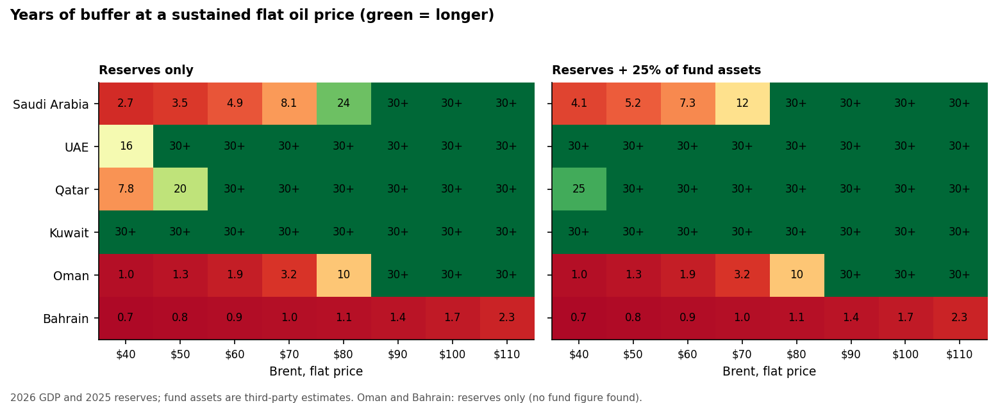
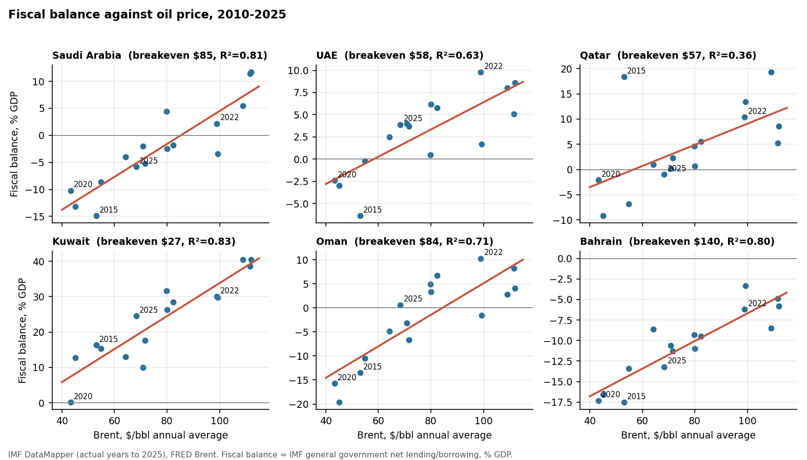
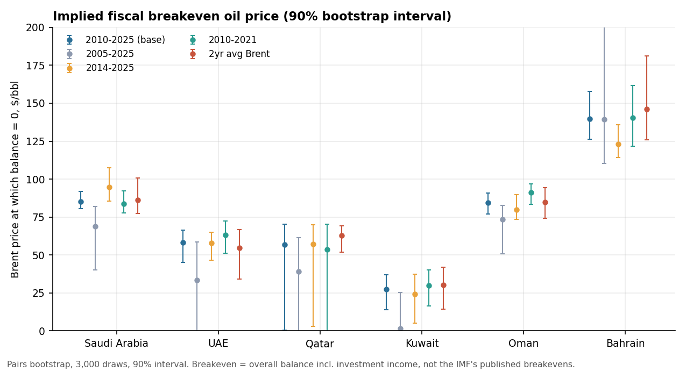
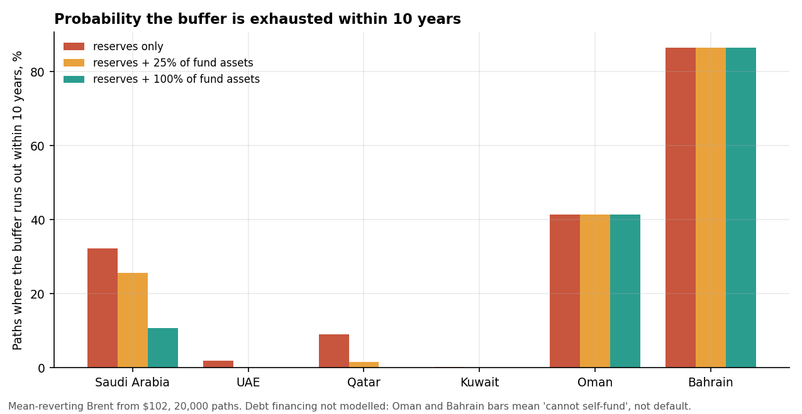

# At what oil price do Gulf governments run out of room?

A fiscal stress test of the six GCC states (Saudi Arabia, UAE, Qatar, Kuwait, Oman, Bahrain) on
public data (IMF, World Bank, FRED), 2010-2026. It estimates how each government's fiscal balance
responds to the oil price, how long reserves and sovereign fund assets could fund a deficit at a
sustained low price, and how often a simulated oil price path would exhaust them.

**Short answer:** Saudi Arabia and Oman are the oil-sensitive ones: their balance hits zero at about
$85 Brent (90% interval $80-92 and $77-91), above the 2025 average of $68. The UAE and Qatar balance
near $57-58 (Qatar's estimate is unreliable). At a sustained $60 Brent, Saudi Arabia's reserves plus
a quarter of PIF-scale fund assets last about 7 years; at $50, about 5. In simulation, 5.8% of
5-year paths exhaust that buffer for Saudi Arabia (12.9% on reserves alone), against about 0% for the
UAE, Qatar and Kuwait. Oman and Bahrain cannot self-fund a deficit at all: they depend on borrowing
or neighbours' support.



## Method

1. **Balance model** (`src/breakeven.py`): per country, IMF general-government net lending/borrowing
   (% GDP) regressed on the annual average Brent price, 2010-2025 (16 observations each). The
   **breakeven** is the Brent price where the fitted balance is zero. Confidence intervals come from a
   pairs bootstrap (3,000 draws).
2. **Flat-price runway:** deficit in USD at each constant Brent price (2026 IMF GDP) divided into
   the buffer. No simulation, so it carries the fewest assumptions.
3. **Oil price simulation** (`src/sim.py`): mean-reverting log Brent (AR(1) on 1990-2026 monthly FRED
   data: persistence 0.991 a month, half-life about 6.4 years, long-run level about $73), with
   block-bootstrapped residuals, starting at the latest monthly price ($102 in Sep 2026), 20,000
   paths, 10 years.
4. **Buffer simulation:** each path draws a bootstrap (intercept, slope) pair and a residual for each year,
   converts the balance to USD at 3% nominal GDP growth, and tracks the buffer with no investment
   return (conservative). "Exhausted" means the buffer goes below zero.
5. **Buffers:** central bank reserves (World Bank) as the hard floor, with two variants adding 25% and
   100% of estimated sovereign fund assets (`src/assumptions.py`).

## Results

### Breakeven oil price (balance = 0), 2010-2025 sample

| Country | Breakeven, $/bbl | 90% interval | R² | Out-of-sample RMSE, model vs naive (pts GDP) |
|---|---|---|---|---|
| Saudi Arabia | 85 | 80-92 | 0.81 | 2.2 vs 4.3 |
| Oman | 84 | 77-91 | 0.71 | 5.5 vs 7.9 |
| UAE | 58 | 45-66 | 0.63 | 3.5 vs 4.0 |
| Qatar | 57 | 0-70 | 0.36 | 8.9 vs 10.1 |
| Kuwait | 27 | 14-37 | 0.83 | 6.0 vs 8.5 |
| Bahrain | 140 | 126-158 | 0.80 | 1.8 vs 4.3 |

Out-of-sample = expanding-window one-step-ahead forecasts of 2016-2025, against carrying last year's
balance forward. The model beats that naive forecast for every country, but the UAE margin is small and
Qatar is poor.



**How to read the numbers**
- **Kuwait's $27** is not comparable with published fiscal breakevens. The IMF balance includes
  investment income, which is large for Kuwait (a 24% of GDP surplus in 2025). It is the price where the overall
  balance reaches zero, not where the oil budget balances.
- **Bahrain's $140** says oil price is not its problem: it has run a deficit every year since 2010 (3-17% of GDP)
  and relies on debt (144% of GDP) and Gulf support.
- **Qatar's** estimate is weak (R² 0.36, interval 0 to 70). Its balance is driven by LNG volumes and
  prices as well as crude.

### Breakeven depends on the sample

| Country | 2005-25 | 2010-21 | **2010-25 (base)** | 2014-25 | 2-yr avg Brent |
|---|---|---|---|---|---|
| Saudi Arabia | 69 | 84 | 85 | 95 | 86 |
| UAE | 33 | 63 | 58 | 58 | 55 |
| Qatar | 39 | 54 | 57 | 57 | 63 |
| Kuwait | 1 | 30 | 27 | 24 | 30 |
| Oman | 74 | 91 | 84 | 80 | 85 |
| Bahrain | 139 | 140 | 140 | 123 | 146 |

I chose 2010 as the start after seeing that adding 2005-2009 weakens the fit (spending grew
sharply after 2010, so the old relationship no longer holds). That choice is a judgement, and the table shows what it
moves: the UAE and Kuwait breakevens are much lower on the longer sample.



### Runway at a sustained flat Brent price (years; buffer = reserves + 25% of fund assets)

| Brent | $40 | $50 | $60 | $70 | $80 | $90+ |
|---|---|---|---|---|---|---|
| Saudi Arabia | 4.1 | 5.2 | 7.3 | 12 | 35 | no deficit |
| UAE | 31 | 68 | no deficit | no deficit | no deficit | no deficit |
| Qatar | 25 | 63 | no deficit | no deficit | no deficit | no deficit |
| Kuwait | no deficit | no deficit | no deficit | no deficit | no deficit | no deficit |
| Oman | 1.0 | 1.3 | 1.9 | 3.2 | 10 | no deficit |
| Bahrain | 0.7 | 0.8 | 0.9 | 1.0 | 1.1 | 1.4-2.3 |

On reserves alone, Saudi Arabia lasts 2.7 years at $40, 4.9 at $60 and 8.1 at $70.

### Simulation: probability the buffer is exhausted (start Brent $102)

| Country | 5 years, reserves only | 5 years, reserves + 25% funds | 10 years, reserves only | 10 years, reserves + 25% funds |
|---|---|---|---|---|
| Saudi Arabia | 12.9% | 5.8% | 32.3% | 25.6% |
| UAE | 0.0% | 0.0% | 1.9% | 0.1% |
| Qatar | 2.9% | 0.0% | 9.1% | 1.6% |
| Kuwait | 0.0% | 0.0% | 0.2% | 0.0% |
| Oman | 27.0% | 27.0% | 41.5% | 41.5% |
| Bahrain | 79.2% | 79.2% | 86.4% | 86.4% |

With 100% of Saudi fund assets counted, Saudi Arabia's 5-year figure is 0.1% and its 10-year figure
10.7%. Probability of at least one deficit year within 5 years: Saudi Arabia 65%, Oman 67%, Qatar 44%,
UAE 41%, Kuwait 7%, Bahrain 97%.



**Treat the 10-year numbers as model-dependent.** Moving the long-run oil price from $60 to $85 moves the Saudi
10-year figure from 31% to 22%; a zero-drift random walk gives 25%. The 5-year numbers and the flat-price table are the
more defensible results.

### Robustness (10-year exhaustion, buffer = reserves + 25% of funds)

| | Base | GDP growth 0% | GDP growth 5% | Asset return 3% | No parameter uncertainty | Long-run Brent $60 | Long-run $85 | Random walk |
|---|---|---|---|---|---|---|---|---|
| Saudi Arabia | 25.6% | 21.7% | 28.2% | 21.7% | 25.6% | 31.0% | 21.7% | 24.7% |
| Qatar | 1.6% | 0.9% | 2.3% | 0.9% | 0.3% | 2.1% | 1.3% | 3.2% |
| Oman | 41.5% | 39.2% | 42.7% | 39.2% | 41.7% | 47.2% | 37.0% | 36.0% |

## What this does not show

- **The war year.** The model uses oil price only. At the 2026 year-to-date Brent average ($89) it implies
  a Saudi balance of +1.1% of GDP, while the IMF projects -6.5%; Qatar +6.7% against -2.8%, Kuwait 28.6%
  against 15.8%. A gap that large means volumes, disruption or spending are doing something price does
  not capture in 2026. I could not tell which. Estimates use actual years only (to 2025).
- **Policy response.** Governments cut spending in 2015-16, which is already part of the estimated slope, but
  the model does not model borrowing, spending cuts beyond history, or support between states. "Exhausted"
  therefore means "needs borrowing or adjustment beyond history", not default. Saudi debt is 32% of GDP, so it has headroom the
  model ignores.
- **Fund assets** are third-party estimates (Global SWF and SWFI, via aggregator pages), not audited. Much of PIF
  is illiquid domestic investment, which is why the central case counts only 25%. The 25% is a
  judgement, and I show 0% and 100% beside it. No figure was found for Oman or Bahrain; Abu Dhabi's
  other vehicles (Mubadala, ADQ) are excluded.
- **Sixteen annual observations per country.** Intervals are wide and relationships are not stable.
- **Heavy tails.** The simulated Brent 95th percentile is $227 and the 5th is $33 by 2031.
- Not a forecast, not investment advice.

## Verification

`verify.py` checks the regressions and the AR(1) fit against statsmodels (differences below 1e-9) and re-implements
the oil price paths and the buffer simulation in plain Python loops with the same random draws (identical
to floating point). It also checks one runway number by hand. It tests the code, not the assumptions.

## Data

- IMF DataMapper (WEO): fiscal balance, debt, GDP; years after 2025 are projections and excluded from estimation.
- World Bank: central bank reserves incl. gold.
- FRED: monthly Brent (POILBREUSDM), averaged to calendar years.
- IMF revenue and expenditure series could not be located through the API, so the model works with the overall balance.

## Reproduce

```
pip install -r requirements.txt
set FRED_API_KEY=your_key        # PowerShell: $env:FRED_API_KEY="your_key"
python fetch_data.py
python run_all.py                # about 1 minute
python verify.py
```
